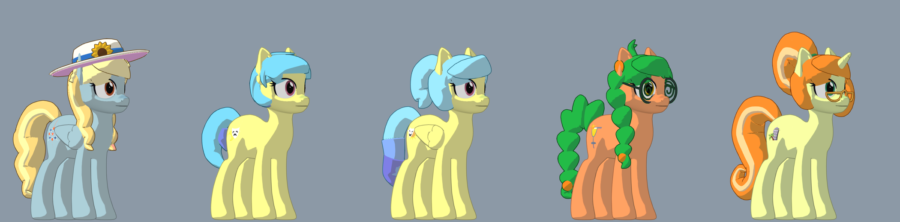
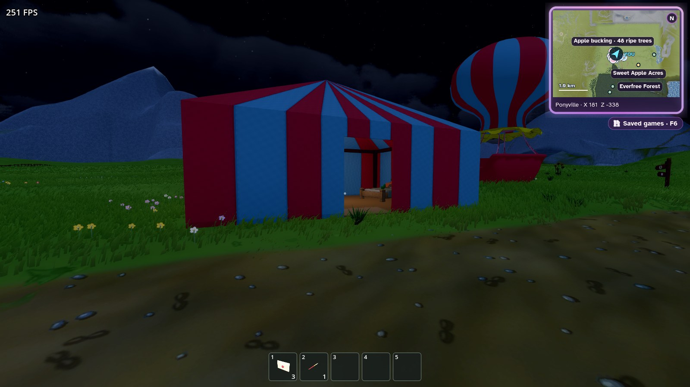

# Mare Fair

A mod for [Home: Equestria](https://github.com/homedevanon/home-equestria) that brings the five
[Mare Fair](https://marefair.org/mascots/) mascots to Ponyville. They camp by the road on the
edge of town in a big striped tent beside their own parked balloon, keep daily schedules, and talk through the game's AI ponies.

Built for game version `0.3.0-maredev`. With the mod switched off, Ponyville is unchanged.



## Download

- **[mare_fair.pck](https://github.com/aptrtek/home-equestria-mare-fair/releases/latest/download/mare_fair.pck)**: the mod itself. This is the only file players need.
- **[mare_fair_source.zip](https://github.com/aptrtek/home-equestria-mare-fair/releases/latest/download/mare_fair_source.zip)**: just the mod's source folder, for anyone who wants to change it.

> **Versions 1.1.0 and 1.2.0 do not work on the packaged game.** They stop it from loading. Use 1.2.1 or newer.

## The mascots

| Pony | Race | Look | Character |
| --- | --- | --- | --- |
| **Fair Flyer** | Pegasus | Two-tone blonde mane and a big wavy tail, wide sun hat with a sunflower | Organises the event |
| **Soirée** | Earth pony | Rounded cyan bob with a level fringe, short crescent tail | Blunt and sardonic; Matinée's twin; married to aperture_tech |
| **Matinée** | Pegasus | Light-blue bob like her twin's, high ponytail in a pink scrunchie, tapered light-blue tail | Bubbly costume enthusiast; Soirée's twin |
| **Morning Mimosa** | Earth pony | Green mane, leafy braids tied with oranges, round spiral glasses | Eccentric |
| **Fun Raiser** | Unicorn | Orange ponytail and curls with a pale streak, gold half-moon reading glasses | Introduces ponies who need something to each other |

Not on the models yet: outfits

## Install

1. Download [mare_fair.pck](https://github.com/aptrtek/home-equestria-mare-fair/releases/latest/download/mare_fair.pck).
2. Put it in your mods folder. **Settings → Mods → Open mods folder** opens it for you.
   On Windows that is `%APPDATA%\home-equestria-public\mods\`.
3. Restart the game. The mod is listed under **Settings → Mods**.

Mods are programs, so only install them from people you trust.

## Meeting them

They live at the **Mare Fair Tent**, marked on the map, by the road on the edge of town. The tent is striped like their balloon, which is parked beside it: a repainted copy of the town's balloon that stays put. Inside are three double beds, a lamp on the table, and a poster somepony keeps putting up. They take no houses in Ponyville, so nopony who lives there is moved or has to share. The mod author is married to Soirée, the tent is his home too, and he shares a bed with her; however, (you) will not be able to. I am going to put this project under a license that restricts modifications to her marriage status if I see things like that.



From the console you can also bring one to you:

```
spawn fair flyer
spawn soiree
spawn matinee
spawn morning mimosa
spawn fun raiser
```

## Talking to them

They use whichever AI you have set up on the game's **Dialogue & microphone** page. That includes
a free local model through [Ollama](https://ollama.com) (`http://127.0.0.1:11434/v1`).

The ponies know you by the `player_name` in your `ai_config.json`, which on Windows is in
`%APPDATA%\home-equestria-public\`. Soirée is married to aperture_tech. Anyone else gets the
honest version: she will tell them she is married, and turn them down.

## Hats and glasses

Fair Flyer's sun hat and Morning Mimosa's and Fun Raiser's glasses are worn by default. Ask them to take one off or put it back on and they can decide to, and the world remembers.

You can also take one off by hand and carry it. On desktop, look at it and press **Y**. In VR, put a free hand at her head and pull the trigger. Do the same while holding it to put it back, or hand it to her as a gift. Taking it without asking is up to her: a friend may laugh, and anypony else will mind. A sleeping pony who trusts you stays asleep. One who doesn't wakes up cross and keeps it.

## Working on the mod

You need the game's source project, the `source-data` zips from the matching release, and Godot
4.5 stable. `mods/README.md` covers the setup. Then:

```
# Run the game with the unpacked mod
godot --xr-mode off --path . -- --mod-src mare_fair

# Check the mascots are all present
godot --headless --xr-mode off --path . --script res://tools/mare_fair/check_mascots.gd -- --mod-src mare_fair

# Build the .pck
godot --headless --xr-mode off --path . --script res://tools/modding/build_mod.gd -- mare_fair
```

### Hair and accessories

Each mare's mane, tail and any accessories live in one file, `hair/<id>.glb`, built by
`hair/build_<id>_hair.py`. The scripts need Python with numpy. Each one edits its `.glb` in place
and reuses the skeleton already in the file, so the hair follows the game's head, neck and tail
bones.

```
python mods/mare_fair/hair/build_soiree_hair.py
```

The same scripts write the removable hat and glasses to `accessories/`. Reopen the project afterwards so
Godot reimports the file.

## Credits

The Mare Fair mascots belong to Snowpity Inc. This is an unofficial fan
mod. Colours, bios, cutie marks and hair are based on the public art on
[marefair.org](https://marefair.org/mascots/). The cutie marks are that site's public vectors. The
reference pictures are not included. The 3D hair and accessories are original to this mod.

The mares' personalities draw on the
[Mare Fair character card by SS](https://mlpchag.neocities.org/view?card=SS/Mare%20Fair.png).
